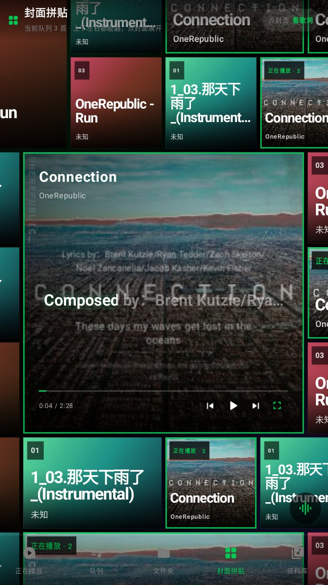
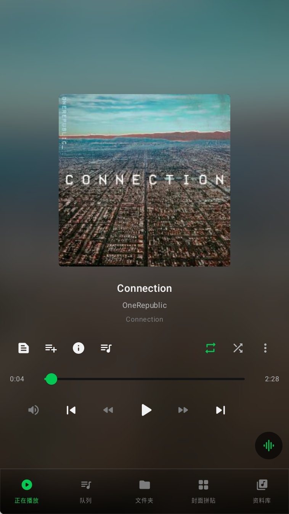
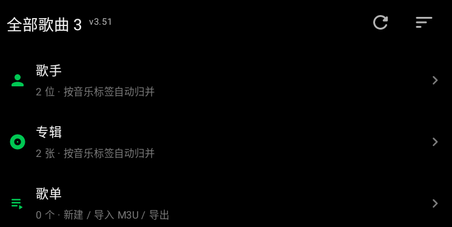
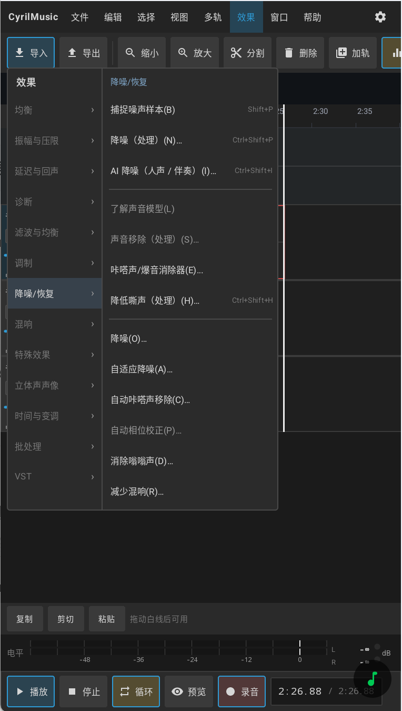
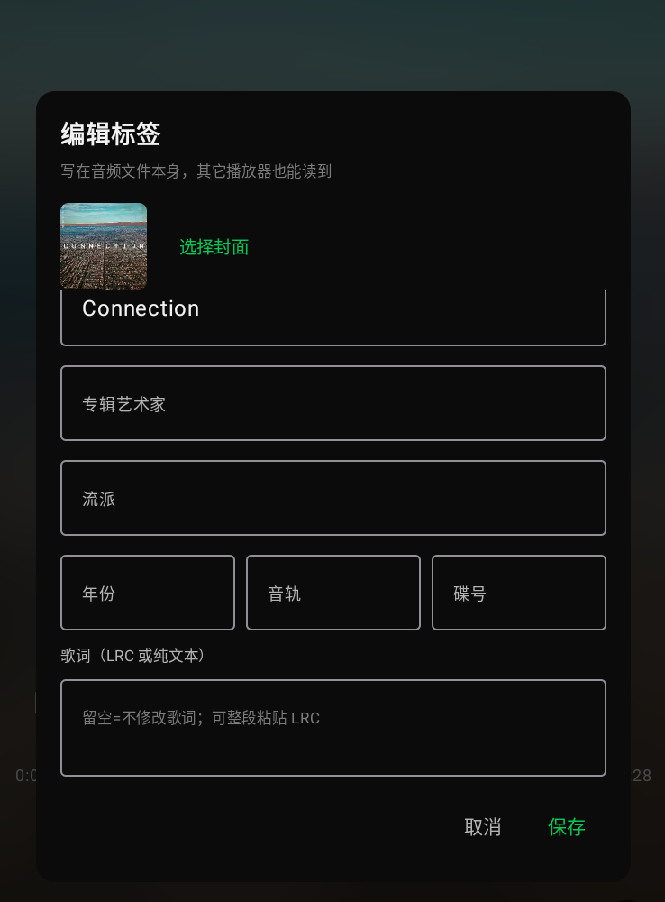

# CyrilMusic

**纯本地音乐播放器 + 多轨音频编辑器。** 单 Activity、全 Jetpack Compose，**无 `INTERNET` 权限** ——
曲库、标签、歌词、歌单全部本地处理，一个字节都不往外发。

<p align="center">
  
  
  
</p>
<p align="center">
  
  
</p>

## 下载

最新 APK 在 [Releases](https://github.com/Cyril-caibao/music-terminal/releases) 页（`CyrilMusic-3.51.apk`，
约 53MB，arm64-v8a + armeabi-v7a，Android 7.0+）。安装包用固定密钥签名，升级可直接覆盖安装。

## 功能亮点

- **多轨编辑器**：逐片段剪辑、零分配实时混音、等功率声像、前视限幅；效果链含 10 段参量 EQ、
  混响、声像、变调；**AI 降噪人声档内置 DeepFilterNet3 官方预训练权重**（ONNX Runtime 推理，
  与官方 `deep-filter` 逐样本相关度 0.989），伴奏档走 noisereduce 式统计分带掩码；
- **播放器**：队列 / 文件夹 / 封面拼贴 / 资料库四个视图；歌手、专辑按音乐标签自动归并；
  标签编辑直接写进音频文件本体（其它播放器也能读到）；歌词支持 LRC；
- **电平表**：L/R 双声道 + 过载锁存灯，表与播放白线共用同一个时钟（0dBFS 进 = 0dBFS 出，
  与 Audition 等工具读数一致）；
- 149 项单元测试（含 DeepFilterNet3 真权重集成测试与像素回归），详见下方版本历史与验证清单。

---

### 3.59 的改动

**用 CyrilMusic 打开音乐（打开方式注册）**

- 文件管理器里长按音乐文件 → 打开方式，会出现两个入口：**CyrilMusic 播放**（立即单独成队播放）和 **CyrilMusic 编辑标签**（直接弹出标签编辑器，关掉即退出）；
- 支持 content:// 与 file:// 两种来源，按 MIME（audio/*）和常见扩展名（mp3/flac/wav/m4a/ogg/opus/aac/ape）双重匹配；
- 外部打开的文件不在曲库里时自动让系统扫描入库；已在曲库里的歌不会因为外部打开而被 MediaStore 的空字段抹掉已改过的标签；
- 外部打开队列固定复用一条，不占 20 条队列上限、不动用户自己的队列；冷启动外部打开时，首扫完成后的「恢复上次播放」不会再覆盖刚打开的歌。

### 3.58 的改动

### 3.58 的改动

- **标签编辑「重启后复原」修复（以文件本体为唯一事实）**：
  - 之前重扫曲库时直接拿 MediaStore 数据库的列覆写曲库，而系统媒体库的列
    滞后于文件内容（且流派/专辑艺术家/碟号等字段重扫时根本没查）——
    文件明明改成功了，重启重扫一遍就被旧列/默认值「复原」；
  - 现在已知文件内容变化时，重扫会**回读文件里的真实标签**入库
    （首次扫描不解析，速度不受影响）；
  - 写完标签后**回读文件验证**：确认标题/歌手/专辑等真的写进了文件本体，
    没写进去就如实报「写入未生效」，不再假装成功；
  - 流派列只在 Android 11+ 才写进 MediaStore（该列低版本不存在，必抛错被吞）；
    媒体库列同步失败不再静默，会明说；
  - Android 9 及以下保存前先检查/申请存储写权限，不再裸跑抛含混异常。

### 3.57 的改动

- **封面拼贴展开卡歌词重做**：换句时「晃一下」修复。
  旧版是「固定 5 槽轨道 + 整块 snap 弹回 + 槽内文字再滑一遍」的两层动画叠加，
  每次到下一句词整块会抖一下；现改为与正在播放页歌词面板同一套逻辑——
  整份歌词 LazyColumn 滚动，当前行高亮、其余行淡化，双语整段一起亮，
  远距离（拖进度条/切歌）直接跳、近距离平滑滚动，不再有多余的弹跳。
- 排版基准图已重新录制（Paparazzi）。

### 3.56 的改动

- **标签 + 封面同时写入失败修复**：某些格式的标签（GenericTag / ID3v1 等）
  不支持内嵌封面，jaudiotagger 的 `setField(artwork)` 会直接抛
  "Not implemented for this format"，把整次写入（含已改好的文字标签）一起报废。
  现在封面写不进去时**不再陪葬**：文字标签照常提交；带封面 commit 失败也会
  摘掉封面重试一次；封面自动降级为应用内封面（显示优先于内嵌），
  界面提示「已写入 N 首：封面未能写进文件…」。

### 3.55 的改动

- **设置页底部留位**：设置主页（歌曲库及标签）滚动内容尾部只留了 24dp，
  最后一行「存储设备」被浮在底部的导航栏盖住（横屏尤其明显）。改为留 110dp，
  与二级页一致。已排查全部页面：资料库 / 歌手 / 专辑 / 歌单 / 队列 / 文件夹
  均有 88dp 留位，封面拼贴是自由平铺画布不存在固定底部元素，无同类问题。

### 3.54 的改动

- **横屏专属布局**：横屏时屏幕高度放不下竖排的「封面 + 信息 + 控件」，
  底部传输键会被浮在内容上的底部导航栏整个盖住。横屏改为左右双栏 ——
  左栏封面（按剩余高度自适应缩放）+ 曲目信息，双击封面仍可看歌词；
  右栏工具行 + 进度条 + 传输键；整块内容垫高避开导航栏。
  竖屏版式不变。工具行 / 进度条 / 传输行 / 曲目信息抽成共用组件，两版同一套逻辑。

### 3.53 的改动

- **坏文件自动容错**：曲子中途坏一段不再整首卡死 —— 播放器从报错点往后跳
  （2s → 5s → 10s 递增），跳过损坏的部分继续放这首；跳 3 次仍失败或坏段贴着曲尾
  就自动切下一首；连续失败超 10 次才停下报错，防止坏队列死循环；
- **冷启动恢复**：打开应用回到上一次播放的歌曲和进度（不自动出声），
  游标本就落库，现在启动时按活动队列的 cursor 复位；
- **返回键逐级回退**：设置页（二级页 → 主页 → 资料库）和资料库
  （歌手/专辑/歌单/设置 → 歌曲列表）按系统返回键回到上一界面，不再直接退出应用；
- **「添加文件夹」按钮**：不再固定在屏幕底部被导航栏盖住，改为紧跟列表内容下方。

### 3.52 的改动

资料库右上角新增 **⚙ 扫描设置**（「歌曲库及标签」）：

- **需扫描的文件夹 / 已排除的文件夹**：二级页 + 添加对话框（可搜曲库已知目录，也可直接输入路径）；
- **两个排除项全局生效**：过滤只发生在扫描入口 —— 被排除的文件根本不进曲库，
  播放 / 文件夹 / 专辑 / 歌手 / 队列自然全部看不到；改完设置自动触发重扫清掉已有条目；
- **排除短时长的文件**：mm:ss 对话框，空或 0:0 不排除任何文件；
- **使用 folder.jpg、cover.jpg 等文件**：内嵌封面缺失时回退到目录里的标准名图片，开关一键关掉；
- **信息**：支持的文件类型、存储设备；
- 目录比较**不区分大小写**（Android 存储 FAT/exFAT 本来就不敏感，这条由测试钉住）。

### 3.51 的改动

### 1. 电平表读数偏低 6dB —— 真因是 pan 法则叠了两层

用户的原话是「电平条不准，同一首歌在 AU 中会超载」。查下来不是表画错了，是**进表的信号被白扣了 6dB**：

`AudioEngine.accumulate` 里音轨 pan 和片段 pan **各乘一次等功率系数** `cos/sin`，
而这两个 pan 默认都在正中 ——

```
cos(π/4) × cos(π/4) = 0.7071 × 0.7071 = 0.5 = −6.02 dB
```

一首 0dBFS 的母带进了 App 只剩一半幅度。AU 那边看是满幅（"超载"），这边表停在 −6，怎么都对不上；
而且这不是"显示问题"，声音本身也真的小了 6dB。

现在：

- 声像改成**平衡法则**（`panBalance`）：正中 1.0 / 1.0，往一侧推只是把另一侧压下去（硬左 = 1.0 / 0）；
- 音轨 pan 与片段 pan **先相加合成一个**再作用一次，不再相乘；
- `Project.renderMixRange`（复制/渲染一段混合总线）走同一套，避免"播放对了、复制又错"。

`MixLevelTest` 把「0dBFS 进 = 0dBFS 出」钉住了：0.99 的立体声素材过总线后仍是 0.9900（−0.09dBFS），
硬左时 L 0.9900 / R 0.0000。

### 2. 表头弹道搬进引擎，界面不再二次平滑

以前引擎给「每块瞬时峰值」，界面再按 0.9 / 0.3 平滑一次 —— 两级平滑叠起来就是"慢半拍"，
而且 21ms 轮询会整块跳过，瞬态峰值漏读。现在：

- 引擎按**正在播出的那一块**给弹道：起振瞬时（一个采样不漏）、回落 22dB/秒、表底 −60；
- 界面每显示帧（`withFrameNanos`）照抄，不再自己平滑；
- **过载灯改成"播到才点亮"**：以前写在前面的块会提前 40~100ms 把灯点亮，这也是"不一致"的一条；
- **循环跨过末尾**时按两段分别记峰值：一块其实覆盖 `[start,end)` 和 `[0,g)`，
  以前记成一个区间，白线绕回 0 后表再也找不到块，会冻在上一个值上。

### 3. 导出：钳位而不是溢出翻转，并且直接报峰值

`ExportAudio` 里原来是 `(x * 32767f).toInt().toShort()`：`|x| > 1` 时整数溢出会翻转符号
（1.2 → −26216），听感是一声爆响，在 AU 里看是满幅方波。现在统一走 `pcm16()` 钳到 ±32767。
导出完成的提示里附带混音峰值，超过 0dBFS 直接写「已削波」—— 不用等文件拿到 AU 才发现。

---

## 3.50 的改动

### 1. 电平表：双声道、过载灯、和声音同一个时钟

以前的表只有一个值：`max(|L|, |R|)` 一条条子，一边过载一边正常完全看不出来（EQ 页更离谱 ——
画了两条竖条，喂的却是同一个值，两条永远一样长，"双通道"是假的）。

现在：

- **L / R 各一条横条**，各带自己的读数、峰值保持线和过载灯；
- **过载灯**：本块只要有采样撞到 0dBFS（|x| ≥ 1.0）就点亮，而且**锁存**——瞬态只有几毫秒，
  不锁存的灯等于没做。点灯（或下次按播放）复位，两条灯各管一边；
- **对不上音乐的根因**：`fillBlock` 算的是「刚写进 AudioTrack 的那一块」，
  而耳朵听到的是缓冲里更早的一块，两者差着整个缓冲区（40~100ms）→ 表抢在声音前面亮。
  现在每个渲染块的峰值都带着帧号记进一个 64 深的环，渲染线程每轮按白线位置
  （`playheadFrame` 本来就是跟 `playbackHeadPosition` 走的）去取**那一段正在响的**峰值，
  表与白线共用同一个时钟；
- 取数周期跟着块走（1024 帧 ≈ 21ms），上升 0.9 / 回落 0.3 —— 抬得太慢会把鼓点糊成一片。

`LevelMeterShotTest` 用 Paparazzi 把三种状态截成一张图（正常 / 声像偏 / 左声道过载），
条长是逐像素量过的：-12.4dB 落在 270px、-6.2dB 落在 299px、3.2dB 落在 345px，与刻度换算一致。

### 2. 资料库：歌手 / 专辑（按标签自动归并）

资料库顶部现在是三行入口：**歌手 · 专辑 · 歌单**。

- 歌手 / 专辑**从标签现聚合，不落表**：它们完全由 `songs` 派生，批量改标签、重扫之后
  再单独维护两张表迟早对不上；曲库在内存里就几万条，`groupBy` 一次是毫秒级，
  跟着 `observeAll()` 的 Flow 刷新反而永远是对的；
- 专辑按**专辑名**聚合，不是「专辑名 + 歌手」：一张专辑里有合唱/feat. 时歌手字段并不统一，
  按组合并会把一张专辑拆成好几张；歌手统一就显示那个名字，不统一才显示「多位歌手」；
- 专辑内按 `disc / track` 排序（专辑本来的顺序），歌手页按标题排；
- 空标签统一并到「未知」，不会把空字符串当名字显示，也不会一首歌一个分组；
- 二级页有「播放全部」+ 单曲菜单（加入队列 / 播完插播 / 编辑标签），进二级页按返回键回资料库。

---

## 3.49 的改动

### 1. 修「偶尔闪退」：AudioTrack 只归渲染线程一个人碰

旧代码有两处在别的线程动正在播放的 `AudioTrack`：

- `seek()` 在 UI 线程 `pause()+flush()` 一个渲染线程正在 `write()` 的对象；
- `stopRenderer()` 在渲染线程可能还在 `write()` 时就 `release()`。

真机上是 `IllegalStateException: Unable to ... after release`，抛在非主线程 —— 整个进程直接死。
而 `MainActivity` 的全局 handler 只往 `crash_last.txt` 写一行，用户侧表现就是「偶尔闪退，重开又好了」。

现在：

- **seek 只投递一个 `pendingSeek` 标记**，真正的 `pause/flush/play` 由渲染线程在块边界自己执行；
- 所有 `write / playbackHeadPosition` 都包了 try，任何异常都只是安静退出这条线程；
- `stopRenderer()` 先 `join(300ms)` 等渲染线程退出，再 `release()`；
- `-Xmx` 之外的实时约束也守住了：渲染线程优先级提到 `MAX_PRIORITY`。

### 2. 修「片段突然没声」：bufferId 引用计数

旧实现是「删片段就 `AudioBufferStore.remove()`」，但同一条 buffer 会被多个片段共享：
剪贴板连粘两次、复制一段再粘贴、分割后再复制…… 删掉其中一个片段，
**另一个片段的音频凭空消失**（波形空、播放没声），而且没有撤销栈。

现在 `AudioBufferStore` 只管 `put / retain / release / refCount`：
片段引用时 retain、删除时 release，引用归零才真正丢弃数组。
`splitClipAt / deleteRange / removeClip / removeTrack / clearAll` 全部改成 release，
分割出的两个半段也补上了 `peaksR`（之前右声道波形是空的）。

### 3. 实时混音：零分配、零加锁

旧 `fillBuffer` 是「逐帧 × 逐轨」：

- 每采样调两次 `panGain()`，每次 `new` 一个 data class → 20 轨 44.1kHz 下**每秒 176 万个临时对象**；
- 每采样 `AudioBufferStore.get()`，而它是 `@Synchronized` → **每秒 88 万次加锁**；
- 每块还新分配两个 `FloatArray(1024)`。

GC 一抖就是爆音，这就是「多轨一多就卡」的根因。现在改成「逐片段 × 逐块」：
一条 clip 每块只查一次 buffer、只算一次声像/增益/淡变系数，内层只剩 `+= 采样 * 系数`，
块缓冲全部复用。离线导出（`renderMix`）共用同一套 `accumulate`，所以**导出和试听完全一致**
（包括主总线 EQ 与 masterGain，之前导出漏掉了 masterGain）。

### 4. 极限外放不再「炸」：+9dB 推子 + 5ms 前视限幅

3.44 那版是纯 `+12dB`、不做任何限制，手机上等于全频段方波 —— 用户听到的是炸，不是响。

现在：

- 增益 **+12dB → +9dB**，低频提升 +8.3dB → +6.5dB，3D 宽度 700 → 520，混响湿声减半；
- 出口串一道**前视 5.8ms 的立体声联动限幅**（单调队列取窗口峰值，增益提前降下去），
  天花板 **−1dBFS**，释放 150ms；
- 最后一级 tanh 软削波（拐点在 0.9×天花板），保证任何情况下都不越界；
- 关掉极限外放时时**完全旁路**，不引入延迟也不碰采样。

代价是多 5.8ms 延迟（只在极限外放打开时）。换来的是同样的响度、不糊的瞬态。

### 5. 多轨新增 AI 降噪：人声档跑真的 DeepFilterNet3

效果 → 降噪/恢复 → AI 降噪，两档：

| 档位 | 目标 | 本版实际跑的东西 |
|---|---|---|
| **人声** | DeepFilterNet3 | **官方预训练权重**（`assets/dfn3/` 三个 ONNX 图）+ ONNX Runtime，48kHz / FFT960 / hop480 / Vorbis 窗 / 32 带 ERB / 5 阶深滤波 |
| **伴奏** | noisereduce + TinyBandMask | noisereduce 那套统计（15% 分位帧估噪声谱 + 逐 bin 维纳掩码）+ 24 带分带掩码 + 55Hz 以下保护 + 瞬态松手 |

**权重是真的、可校验的**：`DeepFilterNet3_onnx.tar.gz`（官方 v0.5.6 资产，
7,983,136 字节，sha256 `c94d91f70911001c946e0fabb4aa9adc37045f45a03b56008cb0c8244cb63616`），
解开是 `enc.onnx` / `erb_dec.onnx` / `df_dec.onnx`，全部打进 APK 的 assets。

**怎么证明接对了**：拿官方 `deep-filter` 0.5.6（Windows 版）在同一份 48kHz 真实语音上跑一遍，
和本实现逐样本对比 —— **相关度 0.989、偏移 0 样本、电平比 0.94**。这个对照留成了单测
（`Dfn3ModelTest.matchesTheOfficialImplementation`，素材在 `src/test/resources/dfn3/`）。

链路上每一处都是照 `libDF` 抄的，错一处相关度就塌：

- STFT 960 点不是 2 的幂 → 用 Bluestein 化到 2048 点（`BluesteinFft`）；
- Vorbis 窗 `sin(π/2·sin²(π(i+0.5)/480))`，分析侧乘 `wnorm = 2·hop/N²`，
  合成侧**不归一化**（这里多做一次 ÷N 会让整段静音，就是靠 A/B 抓出来的）；
- `feat_erb`：频带平均功率 → `10log10` → 指数均值归一（α=0.99，初值 −60→−90）；
- `feat_spec`：前 96 bin 的复数谱做单位归一（初值 0.001→0.0001）；
- 掩码是 32 带增益，按 ERB 带铺到 481 个 bin；
- 深滤波 `coefs[10]` 是 5 阶复数 FIR，往后看 2 帧，而且吃的是**未加掩码**的原始谱
  （libDF 里 X/Y 两个缓冲，用错会让相关度掉到 0.26）；
- `lsnr` 分级用 C API 默认阈值（−15 / 35dB）。

**伴奏档要说明白**：noisereduce 是纯算法、本来就没有权重；TinyBandMask 查不到公开
checkpoint（官方论文没放、HF/ModelScope 也没有），所以这一档是「结构相同、参数靠统计」，
三根滑条（强度 / 残余底 / 细节）对它真实生效。人声档则相反 —— 掩码由模型输出，
滑条不参与，窗口里已经写了这行提示。

**长素材是分段流式的**（`SEG_FRAMES = 2000`，一段 20 秒，段内再按 250 帧切块），
否则 4 分钟立体声要同时驻留 180MB 以上的浮点数组。分段踩过两个坑，都留了断言：

- 分块要往前多取 26 帧做 GRU 预热，这些帧会被**重复**扫到。若每次都推进 ERB 均值归一，
  等于把时间轴按 1.1 倍速跑（每 250 帧多吃 26 帧），越到后面归一化越偏 ——
  所以 `ChannelState` 记了水位线 `nextFrame`，只有新帧才推进；
- 段 k 的上下文窗口会往前伸 27 个 hop，而那段已经被段 k−1 的**输出**覆盖过了。
  拿降噪后的信号当"原始输入"再分析一遍，共享帧的谱就废了：段缝冒出一段近奈奎斯特的
  爆发，逐采样跳变 0.049，是正常值的 30 倍（听感就是一声"嗒"）。现在覆盖前先留一份原样，
  段首再让出 1 个 hop 做 10ms 交叉淡化。修完跳变比 1.39、全文件最大跳变 0.0041。

代价与边界：

- 人声档吃 CPU：桌面 CPU 5 秒立体声 ≈ 250ms，手机上按 4–8 倍算，4 分钟素材要跑 1–3 分钟
  （走后台 + 进度提示，不卡界面）；
- 44.1kHz 素材先重采样到 48kHz 再换回来（模型只认 48kHz）；
- 立体声左右各推一次（图里 batch 维度固定为 1），耗时≈单声道两倍；
- APK 因为 ONNX Runtime 的原生库（arm64-v8a + armeabi-v7a）和 7.6MB 权重变大。

## 验证

**149 项单测 0 失败**（119 → 127 DFN3 的 8 项；127 → 133 是 3.50；133 → 140 是 3.51；140 → 149 是 3.52 的 9 项，含 ScanFilter 8 项）：

| 新增断言 | 盯的事故 |
|---|---|
| 两个片段共享 buffer，删一个另一个还能出声 | 引用计数漏了 retain/release |
| 剪贴板连粘两次后删原件，两条粘贴都还在 | 静默毁素材 |
| 分割出的两半都有左右声道峰值、id 不互相覆盖 | 连分两次把第一次的缓冲盖掉 |
| **DeepFilterNet3 输出与官方 `deep-filter` 相关度 > 0.85**（实测 0.989） | 窗函数 / 归一化 / ERB 分带 / 深滤波任一处接错 |
| 960 点 Bluestein 正逆变换误差 < 1e-4 | 非 2 幂 FFT 写错，整条链路全废 |
| 静音进 → 静音出；满幅白噪不削顶 | 归一化系数错（−60dB 静音 / 爆音） |
| 44.1kHz 进出重采样后长度不变、无 NaN | 重采样把长度算错、越界 |
| **25 秒素材被迫切成两段，段缝不塌、不爆、不咔哒，全文件无单采样突跳** | 分段流式化丢了状态 / 拿自己的输出当输入 |
| AI 降噪（统计档）：高频噪声降 >5dB、主音保留 >55% | 降了个寂寞 / 人声被吃掉 |
| 伴奏档保住 55Hz 贝斯，人声档必须压掉它 | 两档只是换了个名字 |
| 持续长音不被自己的噪声谱吃掉 | 最小统计的经典事故 |
| 强度 0 逐采样完全不变；强度 90 比 25 干净 | 滑条是假的 |
| 10 秒立体声 < 12s | 有人把 STFT 写成 O(n²) |
| 一张有合唱的专辑不被拆成多张 | 按「专辑名+歌手」聚合 |
| 专辑内按 disc/track 排，不按标题重排 | 专辑页顺序错乱 |
| 空标签并进「未知」，不是一首一个分组 | 标签缺失时列表被撑爆 |
| 电平表三种状态各截一张像素图（Paparazzi） | 两条竖条喂同一个值 / 刻度与条子错位 |
| 资料库三行入口在窄屏上的排版截图 | 三行把列表挤没 / 副标题被截断 |
| 0dBFS 立体声过总线后仍 0dBFS（pan 法则只作用一次） | 双层 pan 相乘白扣 6dB |
| 硬左时 L=1.0 / R=0.0，不是 0.707/0 | 等功率法则用在平衡旋钮上 |
| meterStep 单调不回升、表底 −60dB | 回落速度算成负数导致表往上走 |
| 排除目录的子目录一并排除、排除优先于扫描根 | 只排一层，子目录的歌漏进来 |
| /Music 与 /music 算同一目录、MusicBackup 不算前缀误伤 | 大小写 / 相似名误判 |
| 设置页三组行的排版截图（Paparazzi） | 副标题被截 / 开关压住文字 |

`apksigner verify` 通过（CN=CyrilMusic），`versionCode 62 / versionName 3.49`。

APK 体积：53MB（原 ~16MB）。多出来的是 ONNX Runtime 的原生库
（arm64-v8a 16.8MB + armeabi-v7a 11.7MB，共约 29MB）和 8.2MB 权重。
要瘦身：删掉 `abiFilters` 里的 `armeabi-v7a` 能省 12MB（只留 64 位机）。

## 3.48 的改动（保留）

### 1. 降噪：从「高通 + 噪声门」换成真正的谱减

旧实现只有 80Hz 高通加一道硬噪声门：门限以上原样放行，以下直接归零。它有三个硬伤 ——
尾音会被切得"打嗝"、被切掉的地方变成数字静音（比噪声更突兀）、对"嘶——"这种宽带噪声毫无分辨力。

新实现（`audio/SpectralDenoise.kt`）走 STFT 谱减：

- **分析**：2048 点窗 / 512 跳步 / Hann 窗，75% 重叠相加；归一化用**实际累加的窗权重**，不是固定常数，所以开头结尾不会突然变小声；
- **谱减**：`g = (|X|² − 1.6²·|N|²) / |X|²`，夹到 `[floor, 1]` —— 噪声占主导的频点压到残余底，音乐远大于噪声的频点原样通过；
- **少"水声"**：增益先按「频带宽度」做频率平滑（去掉孤立尖刺），再做时间平滑（下降 0.55、回升 0.08，压得快、松得慢）；
- **立体声链接**：用两声道里较大的那个算增益、两声道共用，声像不会被拉偏；
- **低频保护**：默认 60Hz 以下不动，鼓和贝斯保住。

强度是 0–100% 一根滑条，实际压制量 6–40dB，下面用一行小字翻译成「约 30dB · 噪声被压到 3%」，不用懂 dB 也能调。

**性能**：10 秒素材 108ms（JVM 实测），4 分钟整曲约 2.6 秒，真机预计 5–8 秒，界面有「正在处理」浮层。
快的原因是「频谱直乘」——只把增益乘到复数频谱上，不重建相位，省掉每帧几千次 `atan2/sin/cos`。

### 2. 噪声样本：捕捉、导入、样本库

| 来源 | 用法 |
|---|---|
| **选区捕捉** | 拖一段只有噪声的区间 → 效果 → 降噪/恢复 → 捕捉噪声样本（或「选择 → 用选区作为噪声样本」） |
| **片段捕捉** | 选中一个 ≤10 秒的纯噪声片段，直接捕捉 |
| **文件导入** | 降噪窗口「导入…」，wav/mp3/m4a/flac 都行，解码后取整段平均谱 |
| **样本库** | 捕捉/导入的谱自动落盘（Base64 float，约 4KB/条，最多 12 条），窗口里点 chip 切换 |
| **自适应** | 没样本时，取整段能量最低 12% 的帧估底噪（两遍扫描，内存 O(1)） |

两个刻意的限制：片段超过 10 秒不让当样本（音乐会被算进噪声谱，降噪开始吃人声）；
样本短于 0.15 秒直接拒绝（统计不出谱）。

### 3. 复刻 AU 界面

- **两栏效果菜单**：左栏类别、右栏命令，命令带 AU 的快捷键（`Shift+P`、`Ctrl+Shift+P`）与「…」；暂不支持的命令（声音移除、自动相位校正、VST、批处理）**灰显而不是藏起来**——AU 里也是这样，看得到、点不动；
- **类别**：均衡 / 振幅与压限 / 延迟与回声 / 诊断 / 滤波与均衡 / 调制 / 降噪/恢复 / 混响 / 特殊效果 / 立体声声像 / 时间与变调 / 批处理 / VST；
- **降噪/恢复**下 13 条，顺序照抄截图：捕捉噪声样本、降噪（处理）、了解声音模型、声音移除、咔嗒声/爆音消除器、降低嘶声、降噪、自适应降噪、自动咔嗒声移除、自动相位校正、消除嗡嗡声、减少混响；
- **菜单栏**改成 文件 / 编辑 / 选择 / 视图 / 多轨 / 效果 / 窗口 / 帮助，新增的「选择」里有：全部、当前片段范围、从播放头到结束、用选区作为噪声样本；
- 其它恢复类效果也真的能用，不是摆设：
  - **消除嗡嗡声**：用 50/60Hz 的 DFT 能量投票判工频，再对基频 + 8 次谐波做 Q=30 窄带陷波（级联两级），1kHz 处只掉不到 10%；
  - **自动咔嗒声移除**：二阶差分突变检测（阈值随局部 RMS 自适应），命中后用两端线性插值补平；
  - **降低嘶声**：只对 3kHz 以上做谱减，齿音和镲片不会被一起压闷；
  - **减少混响**：给每个 bin 记历史峰值包络，幅度低于包络（说明在衰减）时按比例压尾，稳态直声几乎不动。

### 4. 底部电平条

「电平」两个字 + 横向色条 + 数字读数，位置在走带条上方：

- 取的是**渲染线程算出的总线真实峰值**（多轨叠加过载之后），不是按轨道音量估算的，推爆时它真的会顶到红区；
- 量程 -60…+6 dBFS，渐变 绿→黄→橙→红，0dB 画一条亮线；
- 峰值保持 1.5 秒，之后以 1.2dB/帧回落，瞬态看得清；
- 刻度数字直接画在 Canvas 上，和条内格线共用同一套坐标，不会错位。

### 3.48 的验证（保留）

**104 项单测 0 失败**，其中 12 项是 3.48 新增的降噪硬指标：

| 断言 | 盯的事故 |
|---|---|
| 噪声降 >8dB、主音保留 >75% | 降了个寂寞 / 把人声一起吃掉了 |
| 强度 95 比 20 更干净 | 滑条是假的 |
| 强度 0 的改动小于强度 90 | 一上来就过度处理 |
| 50Hz 降 80%、1kHz 保留 90% | 去嗡声把低频全砍了 |
| 脉冲被削平、咔嗒被检出 | 咔嗒消除只是摆设 |
| 10 秒降噪 < 6 秒 | 有人把频谱直乘改回相位重建 |

`apksigner verify` 通过，`versionCode 61 / versionName 3.48`。
预览图：`预览-AU效果菜单.png`、`预览-降噪.png`、`预览-多轨界面.png`（都是 Paparazzi 实拍）。

## 功能概览

- **正在播放**：模糊封面背景、拖动进度、双击封面看歌词、加入歌单、倍速滑块 / 定时关闭滑块 / 随机 / 循环 / A-B 复读、音效（10 段均衡、超低重音、3D、混响、输出增益、极限外放）、音量自动补偿、通知栏三态入口、后台播放白名单；
- **队列**：可拖动排序、单曲移除、搜索（顶部，容错）；
- **文件夹**：按目录浏览，整目录入队；
- **封面拼贴**：二维无限拼贴墙，四向拖动、点封面原地展开、切歌时窗口跟着正在播放的那张卡走、卡内歌词逐行过场；
- **资料库**：全部歌曲、歌单（新建 / 重命名 / 导出 M3U / 删除）、多选批量加入歌单、扫描全盘音乐、标签编辑、容错搜索；
- **多轨编辑**：20 轨、录音、导入、WAV 导出；AU 式两栏效果菜单；降噪（谱减 + 噪声样本库）、AI 降噪（人声 / 伴奏两档）、去嗡声、去咔嗒、降嘶声、减混响；10 段图形 EQ / Pro-Q；底部主输出电平表；
- **通知栏**：极简播放器（封面 + 走带），锁屏、蓝牙线控、Android Auto 走同一个 MediaSession。

## 构建

```bash
export ANDROID_HOME=/opt/android-sdk
export JAVA_HOME=/path/to/jdk17+   # 21 也可以（AGP 8.5 + Gradle 8.7）
./gradlew :app:assembleRelease
```

- AGP 8.x + Kotlin 1.9.24 + Compose BOM 2024.06.00 + Media3 1.4.1 + androidx.media 1.7.0，`compileSdk 35 / minSdk 24`；
- 签名信息读本机 `signing.properties`（不入库）；没有密钥的机器照常构建 debug；
- 单测：`./gradlew :app:testReleaseUnitTest`，共 149 项（含 DeepFilterNet3 真权重集成测试、MixLevelTest 混音增益校准、ScanFilter 排除语义，
  它读 `app/src/test/resources/dfn3/` 下的对照素材，不依赖网络）。

## 权限

| 权限 | 用途 |
|---|---|
| `READ_MEDIA_AUDIO` / `READ_EXTERNAL_STORAGE` | 读曲库 |
| `POST_NOTIFICATIONS` | 通知栏播放器（Android 13+，启动时 + 开播时各问一次） |
| `FOREGROUND_SERVICE(_MEDIA_PLAYBACK)` | 后台播放 |
| `WAKE_LOCK` | 锁屏继续放 |
| `REQUEST_IGNORE_BATTERY_OPTIMIZATIONS` | 省电白名单，防后台降频卡顿 |
| `RECORD_AUDIO` | 多轨编辑器录音 |

没有 `INTERNET`。

## 目录结构（本版涉及的部分）

```
audio/AudioEngine.kt            实时混音：渲染线程独占 AudioTrack、pendingSeek、逐片段累加、零分配
audio/AudioBufferStore.kt       PCM 仓储 + 引用计数（put / retain / release / refCount）
audio/AiDenoise.kt              AI 降噪：人声档兜底统计掩码、伴奏档分带掩码、音高保护
audio/dfn3/Dfn3.kt              DeepFilterNet3 真权重推理：STFT/ERB 特征/掩码/5 阶深滤波/重叠相加
audio/dfn3/BluesteinFft.kt      960 点 FFT（非 2 的幂，化到 2048 点）
audio/dfn3/Dfn3Assets.kt        assets/dfn3 的懒加载 + 失败原因（不抛异常，可退回统计档）
assets/dfn3/                    官方 v0.5.6 权重：enc / erb_dec / df_dec + config.ini（8.2MB）
audio/SpectralDenoise.kt        谱减降噪、噪声谱提取、自适应估计、去嗡声/去咔嗒/降嘶声/减混响
audio/NoiseProfileStore.kt      噪声样本库（Base64 float 谱，SharedPreferences，上限 12 条）
player/playback/FxAudioProcessor.kt  10 段 EQ / 低架 / 3D / 输出增益 / 极限外放前视限幅
player/playback/AudioFx.kt      音效参数与快照（含极限外放的推子与限幅开关）
model/Project.kt                片段增删改：retain/release 配对、分割补 peaksR
ui/EditorState.kt               效果参数、捕捉/导入样本、AI 档位、异步 applyFxAsync
ui/Bars.kt                      AU 两栏效果菜单、降噪 / AI 降噪窗口、参数滑块
ui/LevelMeter.kt                底部主输出电平表：L/R 双条 + 读数 + 过载灯（峰值保持 / dB 刻度）
player/ui/LibraryGroups.kt      资料库的歌手 / 专辑：按标签聚合 + 二级歌单页（不落表）
test/.../LevelMeterShotTest.kt  电平表像素回归（Paparazzi，三种状态一张图）
test/.../LibraryEntryShotTest.kt 资料库入口排版回归（Paparazzi）
test/.../LibraryGroupingTest.kt 歌手 / 专辑聚合（4 项）
test/.../AiDenoiseTest.kt       AI 降噪（统计档）硬指标（10 项）
test/.../Dfn3ModelTest.kt       真权重集成：与官方 deep-filter 逐样本对照（7 项）
test/resources/dfn3/            对照素材：5 秒 48k 真实语音 + 官方 deep-filter 输出
test/.../BufferRefCountTest.kt  bufferId 引用计数（5 项）
test/.../DenoiseTest.kt         降噪硬指标 + 性能闸门（12 项）
```

## 已知限制

- 降噪是**谱减**，不是 AI 分离：持续性的宽带噪声（风扇、底噪）效果最好；人声和噪声重叠在同一条频率上时，压噪声必然连带压到人声；
- **AI 降噪的人声档内置了 DeepFilterNet3 真权重**（三个 ONNX 图 8.2MB + ONNX Runtime 原生库约 29MB，
  APK 因此从 ~16MB 涨到 53MB）。它是**语音增强**模型，不是"伴奏分离"：对着音乐素材跑，
  它会把乐器当成噪声压掉，只在人声/口播/采访这类素材上正常；
- **伴奏档没有可用的预训练权重**：noisereduce 本身是纯算法（无权重），TinyBandMask 查不到公开
  checkpoint，所以这一档是"结构相同、参数靠统计"，强度/残余底/细节三根滑条对它真实生效；
- 人声档的耗时和手机有关：桌面 CPU 5 秒立体声 ≈ 250ms，按 4–8 倍算，4 分钟素材 1–3 分钟；
  走后台协程 + 进度提示，不卡界面，但确实是"点一下等一会儿"的效果；
- 人声档只吃 48kHz 模型：44.1kHz 素材进出各重采样一次，高频有轻微损失；
- 人声档立体声是左右各推一遍（图里 batch 固定为 1），耗时≈单声道两倍；
- 人声档按 **20 秒一段** 流式处理，深滤波的帧历史与 ERB 归一化状态跨段保留，所以段缝处不会掉电平；
  内存峰值只跟一段走（4 分钟立体声峰值约 8MB，而不是整条数组 180MB+）；
- 统计档（伴奏 / 人声兜底）要跑 3 遍 STFT（估噪声 2 遍 + 掩码 1 遍），4 分钟整曲约 5–8 秒；
- 极限外放打开时前进 5.8ms 延迟（前视限幅的代价），关掉即旁路；
- 降噪不改变片段长度，但会重算波形峰值，处理 4 分钟整曲需要几秒（有进度提示）；
- 噪声样本要选「只有噪声」的一段；拿整首歌当样本会把音乐当噪声，人声会被吃掉；
- 处理是不可逆的（没有撤销栈），重要素材建议先分割出一个副本再降；
- 响度补偿是**静态**的：按整首的综合电平算，不跟段落走，也不改变动态；
- 编辑距离上限是"2–4 字容 1 个错"，1 个字的查询不做模糊，否则等于全匹配；
- 通知能否显示最终由系统（沙盒兼容层）决定；
- 出口是 16bit：平时超过 0dBFS 会硬削波（听感是破音，这是刻意保留的）；开启极限外放后出口有限幅，不再硬削；
- 拼贴墙同时最多绘制 400 张；世界坐标是 Float，连续拖动上百万 dp 后精度会退化；
- 多轨编辑器尚未做工程保存/加载与撤销重做；音频导出仅 WAV。

---

## 3.47 的改动（保留）

- **自动响度补偿**：按每首歌的实测 RMS 与峰值算静态增益（`-14dBFS - RMS`，受 `-0.3dB - peak` 约束），乘在播放器音量上，不碰 DSP；带缓存与下一首预热；
- **容错搜索**：包含 → 子序列 → 编辑距离（2–4 字容 1 个错）→ 多关键词，带归一化 LRU 缓存；
- **多轨界面**：EQ 推子 2px→8px、手指 12px→26px，参数滑条与轨道头滑条同步加粗，字号 +1.5~2sp。

## 3.46 的改动（保留）

- **拼贴墙切歌**：3.45 只换了窗口里的内容，窗口本身不动，于是画面上会出现两张同一首歌。3.46 加了 `followInstance()`：切歌时把展开窗口整体交给新歌**离窗口最近的那一份**，旧卡按让位表缩回、相机 420ms 跟过去；同一张上不重复触发（幂等）；
- **通知栏播放器**：渠道 v1(LOW) → v2(DEFAULT，静音、锁屏可见)；开播时再问一次 `POST_NOTIFICATIONS`；播放 1.8 秒后自检 `activeNotifications`，没挂上就用普通 `notify()` 发一条 MediaStyle 兜底（带 session token，三键直连服务）；菜单三态可手动重发。

## 3.45 的改动（保留）

- **3.44「歌都放不了」**：float 输出回退 16bit（部分机型 float 通道 44.1kHz 初始化直接失败），DSP 仍在 float 域计算，只在出口截断；`queueInput` 加 try/catch；错误码显示在播放页；
- **通知栏**：`USAGE_MEDIA` + `CONTENT_TYPE_MUSIC`、`setHandleAudioBecomingNoisy(true)`、`DefaultMediaNotificationProvider` + 矢量小图标 + `setSessionActivity`；
- **拼贴墙**：展开卡内容跟随当前播放（封面/标题/序号/歌词），字号与换行动画重做（24sp、`AnimatedContent` 上下推）。

## 3.44 的改动（保留）

- **音效链不再用系统 audiofx**：`Equalizer / BassBoost / Virtualizer` 跑在 16bit 域，且 `BassBoost` 带自动增益补偿 —— 越加低频整体越小声。换成自研 `AudioProcessor`：10 段 RBJ peaking（±12dB）、88Hz 低架做超低重音、M/S 扩展做 3D 宽度、额外输出增益推子（−12…+18dB），全程无 AGC；
- **极限外放**：从 `LoudnessEnhancer`（自带压缩+限幅）改为「系统音量拉满 + 12dB 纯增益」；
- **多轨**：`masterGain` 0.85 → 1.0，`AudioTrack` 优先 float 输出（不支持时回退 16bit），`stereoWiden` 去掉 `coerceIn`；
- **倍速 / 定时关闭**：菜单预设档位改成滑块弹窗（0.25×–3.00×、1–180 分钟）；
- **右上角菜单弹到左上角**：`DropdownMenu` 必须和锚点按钮在同一个 `Box` 里，否则锚点变成整行的起点。

## 3.43 的改动（保留）

- **片段「有时候拖不动」**：片段在 `PointerEventPass.Initial` 阶段就 `consume()` 按下事件，不再和滚动赛跑；跨轨改按方向判定；`draggingClipId` 不再泄漏；
- **播放页左下角**：收藏 / 点赞换成「加入歌单」；
- **歌单重命名**：同时把由该歌单生成的队列改名；
- **拼贴墙配色**：哈希从 `sum(charCode) % 360` 换成 FNV-1a（混入标题、艺人、id）；排版照上游；
- **忽略电池优化**：首次进播放器弹说明框，菜单里随时可改。

## 3.42 的改动（保留）

- **点封面时播的不是那一首 / 某些角度有空缺**：世界坐标 dp、触摸 px、`graphicsLayer.translation` px 三者混着加减。density 只在 `pointerInput` 里换算一次；命中抽成纯函数 `hitInstance()`；
- **点谁播谁**：`activate()` 前按 songId 现查队列；
- **余量按格算**：`overscan = cell × 3.9`、`keep = overscan × 1.6`、`step = cell × 1.2`。

## 3.41 的改动（保留）

- **封面不再来自系统猜的图**：只认内嵌封面与同目录（或上一级）的标准名图片，缓存戳 `art-v4`；
- **卡片池**：`WallInstanceStore`（LinkedHashMap，只增不删），封面先查 `ArtImageCache`。

## 3.40 的改动（保留）

- **二维无限世界**：照搬 Folia `layout.ts`，块坐标可正可负；相机是 `graphicsLayer` 上的两个 float；
- **视野收窄**：单元从屏宽÷12 提到屏宽÷7.6；
- **点封面原地放大 + 中间歌词**：展开卡吃 6×6 齿位，块内其余 11 张按让位表重新咬合；
- **新增选项**：标题栏右上角胶囊切换「点封面 → 看歌词 / 开播放页」。

## 3.39 及更早（保留）

- 双语歌词同一时间戳合并成段，整段一起高亮；
- `enableEdgeToEdge()` 修上下灰边；
- 新建歌单可命名；
- `TagOptionSingleton.setAndroid(true)` 修改封面崩溃；
- 队列搜索框移到顶部，歌词刷新 50ms。
